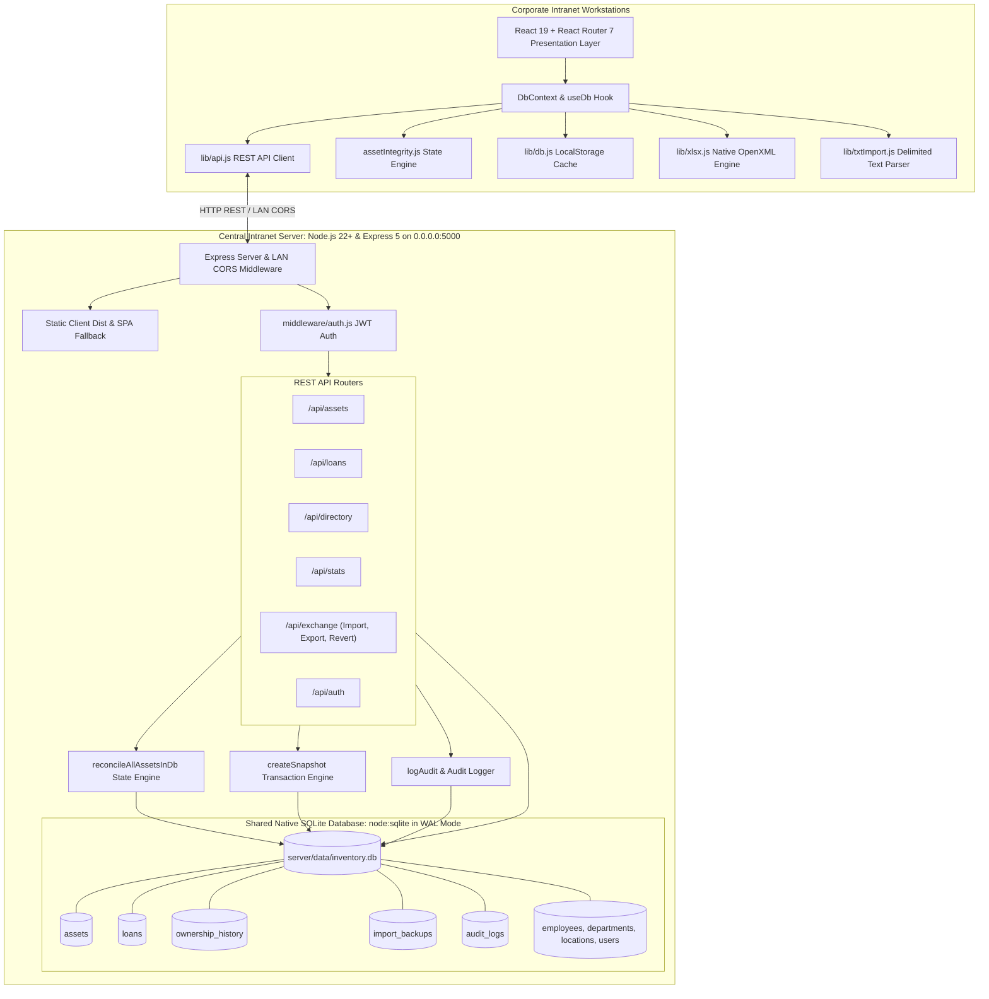
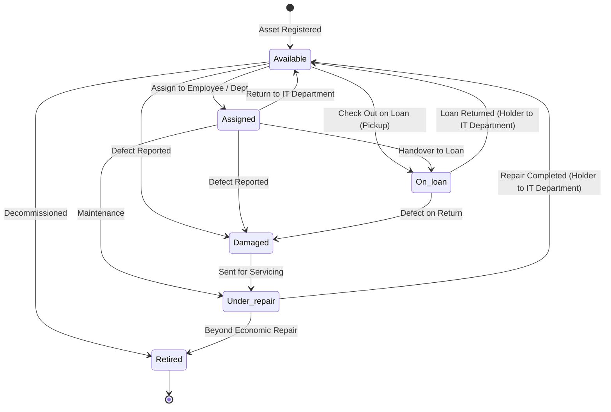

# StarPlus Energy Asset Management System — Software Design Document (SDD)

| Metadata | Details |
| :--- | :--- |
| **Document Version** | **v1.24.11** |
| **System Name** | StarPlus Energy Asset Management System (SPE-AMS) |
| **Document Status** | Approved / Production Specification |
| **Release Date** | November 20, 2026 |
| **Target Environment** | Corporate Intranet Server (Multi-Host Network Deployment) |
| **Tech Stack** | Node.js 22+, Express 5, SQLite (`node:sqlite`), React 19, Vite 6, React Router 7, Vanilla CSS |
| **Related Documents** | [Technical Specification.md](file:///c:/Users/Developer/Documents/workspace/Inventory-Management-Software/Technical%20Specification.md), [PATCH_NOTES.md](file:///c:/Users/Developer/Documents/workspace/Inventory-Management-Software/PATCH_NOTES.md) |

---

## 1. Executive Summary & Document Purpose

The **StarPlus Energy Asset Management System (SPE-AMS)** is a high-reliability, corporate intranet internal inventory and custody management web application designed for StarPlus Energy IT operations. 

The application serves as the **single source of truth** for company hardware (laptops, monitors, peripherals, and network accessories), replacing ad-hoc spreadsheets while maintaining 100% bidirectional data interoperability with corporate Excel workbooks (`.xlsx`) and sharing persistent data across all intranet workstations.

### Core Business Pillars
1. **Asset as Master Record**: Every physical device carries a unique asset code (`SPE-XXXX` or serial number) that remains perpetual regardless of reassignments, temporary loans, maintenance cycles, or returns.
2. **Corporate Intranet Operation**: Deployed centrally on the corporate network (`0.0.0.0:5000`) with zero dependencies on external cloud APIs, remote CDNs, or external typography services (Google Fonts). All assets, styling, and data storage operate strictly within the company network.
3. **Deterministic State Lifecycle & Passive Sync**: A strict state machine enforces valid operational states (`Available`, `Assigned`, `On loan`, `Damaged`, `Under repair`, `Retired`) supported by a non-intrusive background verification engine that actively reconciles custody states.
4. **Unified Custody & Return Lineage**: Full chronological tracking of ownership transfers. When an asset is returned from custody, it is formally received by the **IT Department**, returning its status to **Available** while preserving its prior holder lineage.

---

## 2. Brand Identity & Design System

The application incorporates the formal StarPlus Energy corporate brand guidelines:

### 2.1 Corporate Palette

| Role | Color Name | Hex Code | Usage |
| :--- | :--- | :--- | :--- |
| **Primary** | Corporate Blue | `#1449d6` | Key actions, active states, brand mark, active navigation |
| **Primary Dark** | Deep Navy | `#0a2547` | Headings, brand contrast accents |
| **Primary Light** | Soft Blue Tint | `#eef4ff` | Badges, selection highlights, version pill |
| **Background** | Clean Neutral | `#f8fafc` | Main application shell background |
| **Surface** | Pure White | `#ffffff` | Content panels, cards, data tables, modals |
| **Borders** | Slate Line | `#e2e8f0` | Dividers, card boundaries, table cell borders |
| **Typography** | Slate Ink | `#141519` | High-contrast body text and titles |
| **Muted Ink** | Slate Gray | `#64748b` | Subtitles, labels, metadata, secondary icons |
| **Success** | Emerald | `#10b981` | Available status, healthy indicators, offline status dot |
| **Warning** | Amber | `#f59e0b` | On loan badges, scheduled loans |
| **Danger** | Crimson | `#ef4444` | Damaged assets, overdue loan alerts, destructive actions |

### 2.2 Corporate Mark & Typography
- **Geometric Hexagon SVG Mark**: Custom inline vector hexagon glyph representing StarPlus Energy's battery and clean energy engineering identity.
- **Air-Gapped Typography Stack**: Native system font stack (`-apple-system, BlinkMacSystemFont, "Segoe UI", Roboto, Oxygen, Ubuntu, Cantarell, "Helvetica Neue", Arial, sans-serif`). Zero external network requests to Google Fonts or Typekit, guaranteeing consistent, instantaneous rendering in offline and intranet environments.
- **High-Density Compact Layout**: An ultra-compact topbar (~32px height) eliminating wasted vertical space and maximizing the viewable area for large asset tables and inventory grids. Redundant greeting banners have been eliminated in favor of a clean enterprise header.

---

## 3. Technology Stack & Architecture



| Layer | Component | Specification | Rationale |
| :--- | :--- | :--- | :--- |
| **Backend & Web Server** | Node.js 22+ & Express 5 (`express: ^5.3.0`) | High-performance HTTP API & static SPA server binding to `0.0.0.0:5000` | Multi-host intranet connectivity, LAN CORS, JWT auth, and centralized REST endpoints (`/api/assets`, `/api/loans`, `/api/directory`, `/api/stats`, `/api/exchange`). |
| **Shared Database Engine** | SQLite (`node:sqlite`) | Native Node.js embedded database in WAL mode (`server/data/inventory.db`) | Central single source of truth across all intranet workstations with ACID compliance, transaction rollback snapshots (`import_backups`), and zero external database server daemons. |
| **Frontend Framework** | React 19 (`react: ^19.0.0`) | Modern component model, hooks, concurrent rendering & optimistic UI | Fast client-side rendering with real-time background synchronization (15s polling and focus re-sync) against the central Express server. |
| **Bundler & Dev Proxy** | Vite 6 (`vite: ^6.0.0`) | Lightning-fast HMR and optimized production bundle | Dev proxy targeting `http://127.0.0.1:5000` with graceful 503 error interception when the backend server is offline. |
| **Routing** | React Router 7 (`react-router-dom: ^7.0.0`) | SPA client-side route handling with Express wildcard fallback | Instant view switching across Overview, Assets, Loans, Calendar, Business Travelers, Directory, Exchange. |
| **Styling** | Vanilla CSS Design Tokens | Native CSS variables, zero runtime CSS-in-JS | Complete layout flexibility, no Tailwind dependencies, 100% offline air-gapped styling. |
| **Client Cache & Resilience** | Browser Web Storage (`lib/db.js`) | LocalStorage snapshot cache | Sub-millisecond initial paint, local snapshot buffering, and seamless offline fallback during network disconnections. |
| **Spreadsheet & TXT Engine** | Pure JS OpenXML & Delimited Text Parser | Native ZIP/DEFLATE generator (`lib/xlsx.js`) & TXT parser (`lib/txtImport.js`) | In-browser Excel TXT extraction parser and 1:1 `.xlsx` workbook generation with zero third-party cloud or binary dependencies. |
| **Dev Orchestration** | Concurrently (`concurrently: ^10.0.6`) | Single-command full-stack startup (`npm run dev:all`) | Simultaneously launches Express API server and Vite dev server with colored prefix logging. |

---

### 3.1 Shared UI and workflow ownership

Pages compose shared controls and own only their view state, filters, and workflow entry points. Change the shared implementation when a field or behavior appears in multiple modules.

| Concern | Implementation to change | Consumers |
| :--- | :--- | :--- |
| Default owner, default location, statuses | `shared/referenceData.js` | Browser forms, custody rules, server writes and migrations |
| Equipment keys, labels, descriptions and device types | `shared/equipment.js` | Entry forms, pickup/return checklists, details, transfers and return accounting |
| Form initialization, validation and payloads | `src/lib/loanForms.js` | Create/edit forms and equipment-return entry points |
| Custody presentation, asset lookup and calendar dates | `src/lib/custodyRecords.js` | Traveler roster and equipment calendar |
| Recipient, dates, notes and timestamps | `AssigneeFields`, `LoanDateFields`, `LoanNoteFields`, `TimestampField` | Create/edit, transfers and handover/return windows |
| Location and department choices | `LoanDirectoryFields` and `DirectorySelect` | Create/edit, pickup and ownership transfer |
| Equipment requests and quantities | `EquipmentRequestFields`, `LoanEquipmentSection`, `EquipmentAccessoryList`, `EquipmentQuantityInput` | Create/edit and pickup/return windows |
| Single-record equipment returns | `LoanReturnForm` and `LoanReturnModal` | Assignments & Pickups, Business Travelers and Calendar; bulk selection remains in its page |
| Pickup readiness and tabular custody records | `PickupReadiness` and `LoanTable` | All custody tabs share a sortable Location column; Scheduled and All records share pickup readiness. Visibility is explicit rather than based on CSS column positions |
| Calendar navigation and weekday headings | `CalendarNavigation`, `CalendarWeekdays` and `useCalendarMonth` | Both custody calendars |

`shared/` modules contain no React or database dependencies. Server adapters retain transactions and audit writes; shared metadata and pure rules define the common values. Historical release notes and saved snapshots retain their original content.

Regression checks cover shared form round trips, explicit zero quantities, exact PC/monitor identifiers, partial returns, timestamp callbacks, calendar navigation, and table header/cell alignment across tabs. Run `npm test` and `npm run build` after changing shared code.

## 4. States Version & State Machine Specification (v1.0.0)

### 4.1 Asset States Definition (States Schema v1.0.0)

The system recognizes exactly six mutually exclusive operational states for all hardware items:

| Status | Code | Description | Permitted Current Holder |
| :--- | :--- | :--- | :--- |
| **Available** | `Available` | Asset is in storage/fleet, tested, and ready for immediate deployment or checkout. | Strictly `IT Department`; legacy blank holders are repaired |
| **Assigned** | `Assigned` | Asset is assigned to a specific employee or department for day-to-day work duties. | Must be a named employee or department |
| **On loan** | `On loan` | Asset is out on active temporary custody under a formal loan agreement. | Must match the active loan's `assignee` |
| **Damaged** | `Damaged` | Asset has reported physical or functional defects; held for evaluation. | `IT Department` or reporting employee |
| **Under repair** | `Under repair` | Asset is actively undergoing internal repair or external vendor service. | `IT Department` or Vendor |
| **Retired** | `Retired` | Asset decommissioned, disposed of, or parted out; retained for audit history. | Decommissioned archive |

### 4.2 State Transition Diagram



### 4.3 State Invariants & Business Transition Rules

1. **Active Holder Invariant**:
   - If an asset has an assigned employee or department holder (`owner != ''` and `owner != 'IT Department'`), its status **cannot** be `Available`. The system automatically normalizes the status to `Assigned` (or `On loan` if tied to an active checkout).
   - If an asset is marked `Available`, its holder is normalized to `IT Department` (or empty).
2. **Return to IT Department Workflow**:
   - When any asset is returned from an assignment or loan checkout:
     - The holder is explicitly set to **`IT Department`**.
     - The status transitions to **`Available`** (unless flagged as damaged).
     - An immutable entry is appended to the asset's `ownershipHistory`, recording the previous borrower as `previousOwner`, `IT Department` as `newOwner`, the return timestamp, and the reason `"Returned to IT Department"`.
3. **Passive Verification & Sync Service**:
   - Rather than requiring manual administrative triggers, a passive background integrity service runs automatically during database initialization and state mutations across both client and server tiers:
     - **Frontend Client (`src/lib/assetIntegrity.js` via `useDb.jsx`)**: `reconcileAllAssets()` continuously reconciles local state upon initialization, loan pickup/return, periodic polling (every 15s), and window focus.
     - **Shared Backend Server (`server/db/database.js`)**: `reconcileAllAssetsInDb()` runs directly against the SQLite database during server boot, loan checkout/pickup, return processing, and data exchange imports (`/api/exchange/import`), committing synchronized state updates across all connected intranet hosts.
   - It continuously reconciles loan records against the asset register:
     - If an active loan is picked up and unreturned, the asset status is enforced as `On loan`, and its location and holder reflect the loan record.
     - When all loans for an asset are returned, the asset is automatically freed from `On loan` status and restored to `Available` held by `IT Department`.
     - Normalizes legacy references (e.g. `"pool"`, `"returned to pool"`) directly to `"IT Department"`.
4. **Direct Ownership Transfer**:
   - Clicking on any holder badge in the Assets table directly launches the **Change Ownership Modal**, eliminating the need for a redundant "Actions" column in the table layout.
   - Provides selectable standardized reasons (*"Reassigned to new staff"*, *"New Hire onboarding"*, *"Department Transfer"*, *"Returned to IT Department"*, *"Temporary Handover"*, *"Repaired & Reassigned"*) alongside custom entry.

---

## 5. Unified Ownership History Architecture

Every asset maintains a nested, chronological `ownershipHistory` array:

```json
{
  "id": "e9f1a234-8c90-4e2b-a132-7589d6b45a90",
  "code": "SPE-1002",
  "name": "ThinkPad T14s Gen 3",
  "category": "Laptop",
  "owner": "IT Department",
  "department": "",
  "status": "Available",
  "location": "HQ - Storage Room 2B",
  "updated": "2026-10-07",
  "ownershipHistory": [
    {
      "id": "hist-101",
      "date": "2026-10-07 14:15:00",
      "previousOwner": "Sarah Connor",
      "newOwner": "IT Department",
      "reason": "Returned to IT Department",
      "notes": "Project completed, clean condition"
    },
    {
      "id": "hist-100",
      "date": "2026-03-15 09:00:00",
      "previousOwner": "IT Department",
      "newOwner": "Sarah Connor",
      "reason": "Department Transfer",
      "notes": "Engineering allocation"
    }
  ]
}
```

The system dynamically merges permanent assignments with internal loan checkout/return events via `getAssetEffectiveOwnershipHistory()`, ensuring an unbroken audit trail from initial registration to decommissioning.

---

## 6. Data Exchange Engine (TXT Import & 1:1 Excel Export)

To maximize interoperability with corporate spreadsheet workflows, the application standardizes on tab-delimited text (`.txt`) imports extracted directly from Excel, while preserving exact 1:1 OpenXML `.xlsx` exports.

### 6.1 Supported Import Formats (TXT Extracted from Excel)
The client-side parser (`src/lib/txtImport.js`) runs 100% offline and automatically recognizes:
1. **Equipment Inventory Master (`SPE_Equipments_example.txt`)**:
   - `Asset Number`, `Asset Type`, `Serial Number`, `Purchase Date`, `Status`, `Issued Knox ID`, `Issued Date`, `Department`, `Location`, and `Notes`. Legacy equipment headers remain supported by the parser.
   - Automatically maps statuses (`Issued` ➔ `Assigned`, `Broken` ➔ `Damaged`, `Available` ➔ `Available`).
2. **IT Equipment Loan List (`SPE_IT_Equipment_Loan_List_Example.txt`)**:
   - `Start Date`, `Pickup Date`, `End Date`, `Return Date`, `Laptop`, itemized accessories (`Adapter`, `Cable`, `Dongle`, `Keyboard`, `Mouse`, `Monitor`, `Ethernet cable`), and notes.
   - Accurately parses multiline quoted fields (e.g. `"Charging \r\nAdapter"`), BOM marks, and normalizes Excel null dates (`1/0/1900`).
   - Automatically correlates laptop asset codes with equipment holder records to ensure borrower identities remain consistent.
3. **Batch Multi-File Ingestion**:
   - Allows administrators to upload both files in tandem; the engine cross-references equipment serials and active loans before synchronizing to the shared Express/SQLite database via `/api/exchange/import` and updating the local client cache.

### 6.2 1:1 Reference Excel Exports
Export functionality continues to generate native OpenXML `.xlsx` workbooks:
- `SPE_IT_Equipment_Loan_List_YYYY-MM-DD.xlsx` with exact 1:1 column parity matching the corporate loan register.
- `SPE_Equipments_YYYY-MM-DD.xlsx` matching the equipment master structure.

### 6.3 Shared Database Snapshot & One-Click Revert Architecture
To safeguard corporate records against accidental overwrites or malformed text files during data imports, the system implements a dual-layer transactional snapshot and rollback mechanism:
1. **Server-Side Transactional Snapshot (`createSnapshot` & `import_backups`)**:
   - Prior to executing import mutations via `POST /api/exchange/import`, the Express exchange router automatically calls `createSnapshot()`, generating an immutable JSON snapshot of all current assets, loans, ownership histories, employees, departments, and locations, stamped with a unique snapshot ID (`snap-<timestamp>`) and stored in the SQLite `import_backups` table.
   - The import is executed within a strict database transaction (`BEGIN TRANSACTION ... COMMIT`). If an unhandled exception or parsing error occurs, the server rolls back (`ROLLBACK`) with zero data corruption.
   - An audit record is logged to `audit_logs` capturing the snapshot ID, number of imported assets, updated records, and loans.
2. **Client-Side Snapshot Buffering (`IMPORT_BACKUP_KEY`)**:
   - Concurrently, the frontend client caches a pre-import snapshot to `localStorage` under `IMPORT_BACKUP_KEY` via `saveImportBackup()`.
3. **Admin Backup & Restore (`/backups`)**:
   - Restore history and restoration actions live in the dedicated admin menu, separate from Data Exchange imports/exports. Admins can create a manual restore point, refresh the history and confirm restoration of a selected snapshot.
   - A compact contained table lists up to 50 restore points in newest-first order.
   - The Express server saves current inventory before restoring a selected snapshot transactionally; the client reloads the restored inventory. Accounts, roles and passwords remain unchanged by inventory restoration.

### 6.4 Loan Identity & Duplicate Repair

The preview, client merge, and server importer use `shared/loanIdentity.js`. Matching first uses an existing record ID, then asset and Knox ID/name with start, pickup, or return dates. If only one side lacks start and pickup dates, matching falls back to an asset/person pair only when a single candidate exists. Imported blank start dates remain blank rather than becoming the import date.

Imports remove exact duplicate records. Startup cleanup creates a restore point before clearing start dates later than a return date on records without pickup dates and removing exact duplicates. Cleanup retains records with differing details; import matching updates the matched row while preserving its database ID.

---

## 7. User Interface Layout & Views

The frontend application provides operational views through the left sidebar, admin tools only for admins, and a personal profile through the top-bar account control:

1. **Operations Dashboard (`/`)**:
   - Separate asset KPI cards for Total assets, Available now, Assigned assets, Loaned assets, Broken assets and Under repair, plus distinct Overdue loans, Unreturned records and Current business travelers counts.
   - Interactive category and location distribution diagrams with counts and percentages.
   - Asset cards filter the full-width Recently updated table by the corresponding asset status. Overdue and Unreturned record cards navigate to the matching Assignments & Pickups tab.
2. **Asset Register (`/assets`)**:
   - Complete inventory data grid with multi-column filtering (Status, Category, Location, Search term across all fields).
   - Category choices appear beside the selected-row count and wrap onto another line when the menu is too long.
   - Click and drag row selection with bulk status updates; single and bulk asset deletion in Assets/MES is restricted to admins in both the UI and API. Operators retain editing and import/export.
   - Interactive holder badges: clicking an owner opens the **Change Ownership Modal** directly.
   - Purchase and warranty expiration dates apply to every asset type and accept DD-MM-YYYY entry, converted to ISO before submission without changing existing stored dates or import conventions. Date validation and persistence cover asset editing, imports, exports, and restores.
   - Asset-number edits update linked custody and ownership-history references atomically; failed saves remain open with an error.
   - Clearing Current holder or selecting Available records IT custody and ownership history. Existing missing history is reconciled once with an explicit observation-time note when the original return date is unknown.
3. **Assignments & Pickups (`/loans`)**:
   - Employee laptop handovers are assignments; business traveler handovers are loans. Both share the Scheduled pickup list; picked-up employees appear under Assigned and business travelers under Loans. Return records capture the laptop asset number actually received. Navigation and page headings use Assignments & Pickups; the `/loans` address is retained.
   - Knox ID is the only required field in the add form; full name and PC assignment are optional. A Picked up checkbox beside Due date reveals the pickup-date field for an existing handover.
   - PC search includes Laptop, MES PC, and PC categories; monitor search accepts registered Monitor/Monitors assets. The main table displays PC asset numbers instead of sequence numbers.
   - Active, Scheduled, Overdue, Returned, and Unreturned (partial return) custody management.
   - Employee and traveler requests without pickup dates remain in Scheduled. Scheduled rows show Assignee and omit pickup date, return date, and status columns.
   - Scheduled columns start with Action, Pickup readiness, and Borrower type. Return time is hidden from expanded Scheduled details and scheduled full editing. Overdue omits the return-date column and expanded return time; records with a return date cannot be overdue.
   - Transfers can fulfill an existing schedule selected by Knox ID. Traveler recipients require reviewed start and end dates. Pickup timestamps display in local time, and generated notes use readable recipient details.
   - Equipment transfers accept a destination location and apply it to the recipient custody record and registered transferred assets.
   - Rental location accepts typed values with Directory suggestions. Full editing and pickup retain the requested PC and monitor checkboxes; pickup assigns actual PC and monitor asset numbers.
   - Return forms use checkboxes to select returned devices and accessories, with asset fields aligned on the device row and accessory counts in compact fields beside wider item labels. Missing registered laptops and monitors display their asset numbers. Returned quantities display all recorded equipment, including USB Dongle, monitor, Ethernet cable, and other items. Edit full details exposes the shared returned-equipment controls only for records with an actual return. Corrections recalculate Complete/Partial status and refresh Unreturned membership while preserving current asset custody.
   - Expand a picked-up outstanding loan to transfer all items or selected quantities to another owner. A different Knox ID is required; assignee name is optional. A partial transfer creates an archived Transferred record for moved items, preserves the original active loan for remaining items, and links both records to the recipient custody record and device ownership history. Fully transferred sources are archived as Transferred without a physical return.
   - One-click **"Confirm Pickup"** and **"Return Asset"** workflows.
   - Search across loan fields with selectable field and status filters.
   - Editable accessory checklist and supporting loan details during pickup and return.
   - Mark scheduled incomer equipment as ready for pickup; track returned accessory quantities separately and list outstanding items in the Unreturned section.
4. **In & Out Calendar (`/calendar`)**:
   - Universal schedule calendar tracking hardware checkouts (Out / Departure) and returns (In / Return) across all enterprise personnel.
   - Encompasses all requester types, displaying both standard SPE Employees and mobile Business Travelers.
   - Multi-tier filtering: filter by Requester Type (`Business traveler` vs `SPE employee`), select an individual requester from a categorized dropdown, filter by flow direction (`Out` vs `In`), or search by keyword.
   - Interactive day detail modal with full-width schedule rows, accessory checklists, and direct custody action buttons. Picked-up and completed records leave outgoing schedules; return actions require pickup.
5. **Business Travelers (`/business-travelers`)**:
   - Dedicated mobile workforce custody and field deployment management (accessible via `/business-travelers` with automatic `/travelers` redirection).
   - Its separate day dialog also uses full-width rows. Pending arrivals exclude completed pickups and refresh while the dialog is open.
   - **Exclusive Calendar View Mode**: Operators selecting **"Calendar View"** see solely the monthly schedule calendar (`TravelerCalendar.jsx`), omitting KPI stat cards and location panels for an uncluttered planning experience.
   - **"How Many They Are"**: Real-time KPI statistics include Current business travelers using the same distinct-person rule as Overview, alongside record-based scheduled pickups and overdue loans. A person with several records counts once in the current-traveler card.
   - **"Where They Are"**: Interactive location distribution grid grouping travelers by deployment facility (Kokomo Plant, Regional Office, Detroit Center, IT Office) with one-click filtering.
   - **Overdue Only**: Lists the equipment still outstanding on each overdue traveler record, includes registered asset numbers when available, and starts with the earliest end date. Copy its Knox IDs as `knox_a;knox_b;knox_c;` using the clipboard control.
   - **Full-Screen Full-Body Roster Mode**: 1-click toggle expanding the complete mobile workforce roster across the viewport with sticky column headers and Escape key exit.
   - **Mobile Workforce Roster**: Searchable, filterable table detailing traveler names, Knox IDs, deployed hardware/IP, assignment duration, and countdown badges.
   - **Integrated Workflows**: Direct Return confirmation returning hardware to IT Department, trip editor, and new business traveler dispatch recording.
6. **Asset & Organization Directory (`/directory`)**:
   - Manage asset categories, statuses, departments, and locations. Custom statuses can also be added from asset forms. Search and A–Z/Z–A sorting apply across the Directory; dropdowns default to ascending order.
   - Keep each card heading and its Add/Select actions visible while the list scrolls. Enter submits reference-value edits. Trim outer whitespace while preserving internal spaces.
   - In-use categories and departments remain protected. In-use locations can be renamed or merged into an existing location, updating all matching asset and assignment/loan location references in one transaction. Only unused values can be deleted.
   - Clicking any Directory value opens its matching asset list. Operators can search and edit those assets, then return to the refreshed list; reference-value protection remains separate.
   - IT Office is the default location; IT Department is the owner. Legacy Head Office and IT Department location values are normalized during startup, import, and restore. Under repair assets automatically use service center, with the location locked in single and batch asset forms while that status is selected.
7. **Data Exchange (`/exchange`)**:
   - Tab-delimited text (`.txt`) import extracted from Excel (`SPE_Equipments_example.txt` & `SPE_IT_Equipment_Loan_List_Example.txt`).
   - Interactive preview modal with pre-flight record validation and Merge vs Replace options.
   - Reference-format `.xlsx` OpenXML export maintaining 1:1 column parity.
   - Import/export remains separate from the dedicated admin Backup & Restore view.
8. **Patch History & Release Notes (`PatchHistoryModal.jsx` & `PatchHistoryPage.jsx`)**:
   - In-app release notes viewer accessible via the TopBar version pill, the Sidebar footer, or the dedicated `/patch-history` and `/changelog` routes.
   - Pinned modal header and filter controls with internal single-scroll stream (`.patch-cards-stream`), preventing clipped headers and double scrollbars.
   - Per-version tabbed navigation, real-time keyword search, change type filtering (`All Types`, `Patches`, `Minor`, `Major`), and structured release highlights.
9. **Backup & Restore (`/backups`, admin only)**:
   - Manual restore-point creation, refresh and confirmed restoration in a bounded newest-first history table. Inventory restoration does not restore security accounts.
10. **User Management (`/users`, admin only)**:
   - Account creation, editing, deletion, role assignment and password reset. Passwords have a six-character minimum; account management requires a real persisted admin account.
11. **My Profile (`/profile`)**:
   - The top-bar account name opens the signed-in profile. Admins may edit account details; operators see those details read-only and may change only their own password with the current password. Username is the Knox ID, represented by one identity field. The Corporate Intranet badge is removed.

---

### Account lifecycle and authorization

Admin-only menus and asset deletion are enforced by server authorization as well as UI visibility. An anonymous optional-auth intranet identity cannot perform these operations: the server resolves a real persisted account and checks its current Admin role. User responses contain public profile fields only, and audits record account actions without passwords or password hashes. Profile-field writes from operators are rejected by the API; their permitted self-service operation is password change with current-password verification.

Account creation, admin editing and admin self-profile use a single Knox ID identity. Explicit identity changes synchronize the stored username and Knox ID. Older records with differing values are not silently migrated, and password-only changes preserve those identifiers.

Initial environment account provisioning runs once for a new installation. Existing accounts are adopted without overwriting managed profiles, roles or passwords. An initialization marker prevents restarts from recreating deleted users or resetting credentials. Inventory backup and restore remain separate from this account lifecycle.

## 8. Non-Functional Guarantees

| Requirement | Implementation & Standard |
| :--- | :--- |
| **Air-Gap Compliance** | 100% offline. No telemetry, no external CSS/JS CDNs, no Google Fonts, no remote analytics. |
| **Performance** | Instantaneous search and filter response (< 50ms) via in-memory React state indexing and SQLite WAL indexing (`idx_assets_code`, `idx_loans_asset_code`, etc.). |
| **Compatibility** | Tested on Chromium (Edge, Chrome) and Firefox across Windows 10/11 enterprise workstations. |
| **Data Safety & Shared Persistence** | Centralized ACID transaction persistence via native SQLite (`node:sqlite`) in WAL mode with server-side rollback snapshots (`import_backups` table), foreign key enforcement, audit logging (`audit_logs`), and local browser cache resilience. |
| **Deployment & Orchestration** | Central intranet server (`npm start` or `npm run server` on `0.0.0.0:5000`) hosting both static SPA bundles (`dist/`) and shared SQLite database, or single-command local development (`npm run dev:all`). |

---

### Separate equipment registers

The Assets and MES Equipment navigation entries partition one inventory by MES category or register prefix. They share the register workflow, asset dialogs and table rather than duplicating records or management logic. All asset-table columns support ascending and descending natural sorting; asset number ascending is the initial order. Editable Directory choices reopen with the complete list while retaining the current field value.

The MES page adds Assets and Location views over the same filtered inventory. Location rows show total and per-category counts; expanding a row uses the shared sortable asset table and existing edit/transfer dialogs. Only locations containing matching MES equipment are listed. Counts refresh from inventory state after edits.

Asset creation and editing reuse the editable Directory department selector, including typing to filter, keyboard selection, retained custom values and the existing add-to-Directory action. The same asset dialog serves both registers.

### Register category navigation

The shared Assets/MES register places its All entry and category entries beside the selection count. When entries do not fit on one line, the menu wraps onto additional lines instead of requiring horizontal scrolling. Adjacent actions wrap at smaller widths. Entries come from the current Directory pool plus categories used by the scoped inventory. Names are trimmed, deduplicated case-insensitively and sorted in natural ascending order. Scope rules keep standard and MES menus relevant to their own registers while retaining used categories and zero-count Directory choices. Counts show each category in the scoped inventory before search or status filtering. Category matching retains distinct saved names, including Laptop variants.

All is the initial selection. Category, search and status filters combine before sorting, pagination, exports and MES location grouping. Choosing a category clears row selection and resets paging. Menu choices and counts refresh from shared inventory and Directory state.

### Paged asset browsing and selection

Overview, Assets and MES share pagination and multi-row selection. The default is 15 rows, with 10, 15, 20 and 30 available in the top-right selector. First and Last buttons jump to the beginning or end; Previous and Next move one page at a time. Filtering and sorting precede page slicing so every record remains reachable. Overview recent records retain modification-date ordering across pages. MES location groups and their expanded lists are paged while totals remain complete. Selection spans pages, with a top-left count and explicit clear action; header selection and range selection operate on visible rows. Exports continue to use all matching records.

Range selection can start from a row checkbox as well as a non-interactive row cell. The starting selection determines whether the dragged range is selected or cleared; the release click is suppressed so the endpoint is not toggled twice.

### Department reference integrity

Departments are shared reference values across assets, assignment/pickup history and employees. New saved values register automatically in the Directory as part of the same database transaction. Startup registers missing references from existing records without changing history. Directory usage checks include historical custody and employee references, preventing rename or deletion of referenced values. Client dropdowns and Directory entries derive their choices from the same shared name collector.

The shared Assets and MES register table, including MES location drilldowns, orders columns as Asset number, Category, Status, Current holder, Department and Location, and omits Modification date. Department participates in the existing shared sorting and register search.

### Overview activity and borrower types

Overview groups parenthesized Laptop category variants for chart presentation only. Its asset list shows each asset's latest field changes and a fixed saved timestamp. Existing records with no recorded detail are identified explicitly. Activity metadata participates in the same write transaction and survives database restore and undo.

Contractor is a third borrower identity. Employees retain indefinite assignment rules; contractors and business travelers share due-date loan behavior, including overdue checks and transfer date validation. Borrower identity stays separate from due-date eligibility so contractor labels, filters and spreadsheet round trips remain distinct.

### Assignment activity, unknown dates and location distribution

Recent updates combine the latest real asset change with activity on linked assignment/pickup records, including borrower type changes that leave asset status unchanged. Each saved activity includes the authenticated editor and fixed timestamp. No-op writes, maintenance and restore preserve earlier activity. Unknown times remain undated and sort after recorded times in the default recent list; editor details are not invented for legacy records.

A shared custody policy keeps employee equipment Assigned and business-traveler/contractor equipment On loan through editing and reconciliation. Overview adds a location distribution diagram with counts and percentages next to its category mix. Assignments & Pickups initializes Assigned and Loans to pickup date descending, Overdue to end date ascending, Returned to return date descending, and other tabs to start date ascending. Entering a tab initializes its table with that tab's default while keeping manual sort controls and undated rows last.

### Responsive Overview containment

Wide record tables remain inside shrinking panel/grid tracks with local horizontal scrolling. Overview places its category/location dashboard above a full-width records panel. Charts share a row with a compact three-column summary grid on the right on wide screens. Below 1200px, summary cards move below the charts; below 620px, charts stack and cards retain two columns. Quick actions sit below this dashboard. Main-content limits follow desktop/tablet sidebar sizes; phone navigation becomes a compact header. Action groups and chart labels wrap within available space.

### Dashboard count semantics

Asset counts are derived from inventory status: Available, Assigned, On loan, Damaged (displayed as Broken assets) and Under repair, alongside Total assets. Overdue loans and Unreturned records are independent record counts using the same lifecycle grouping as Assignments & Pickups; a partial return does not become an overdue loan merely because equipment remains outstanding. Records with no tracked PC or monitor still count when accessories remain. These record cards open the corresponding tab instead of filtering assets.

Current business travelers is a distinct-person count shared by Overview, the sidebar badge and Business Travelers. Only business travelers with actual picked-up active or overdue equipment, or partial returns with outstanding items, qualify. Identity uses a trimmed, case-insensitive Knox ID with a real-name fallback only when ID is absent. Schedules, full returns, transfers, employees and contractors are excluded. Multiple qualifying custody records contribute one person; missing identities and event dates are not invented.

### Interactive distributions and independent storage

Overview category and location distributions share one diagram component. Segment and legend hover/focus highlight the same item and expose its count and percentage; keyboard and reduced-motion behavior are supported. The location legend initially shows at most five entries, with Show more and Show less controls when additional locations exist. Folding affects the legend only; every location remains represented in the diagram, counts and percentages.

Custody holder and physical storage are independent. Saving unchanged IT Department custody preserves the selected location, including maintenance states other than the required repair destination. Historical return records do not relocate equipment during reconciliation; actual returns still choose the default destination.

### Directory field whitespace

Rental location and Department use a shared outer-whitespace policy across entry, editing, pickup, transfer and import. Inputs retain spaces during typing, then trim when focus leaves; save paths apply the same rule independently. Internal spaces remain meaningful, whitespace-only values become empty, and omitted fields in partial updates remain omitted. Client record normalization and transfer inheritance prevent padded values propagating. Existing blank schedule-location rules remain in force.

### Calendar event visibility

In & Out and Business Travelers calendars share the same visibility controls and initial state: pickup events hidden, returned records visible. Toolbar and open day-dialog controls use one state per calendar, so event rows and totals update together. Pickup visibility affects pickup events only; return schedules and overdue reminders for equipment already picked up remain visible. Returned-record filtering remains independent.

## 9. Version Control & History

Release notes are maintained in the structured history at [src/data/patchHistory.js](src/data/patchHistory.js). Run `npm run docs:sync` to regenerate the in-app history, patch notes, and document version metadata. The current release is **v1.24.11**.
