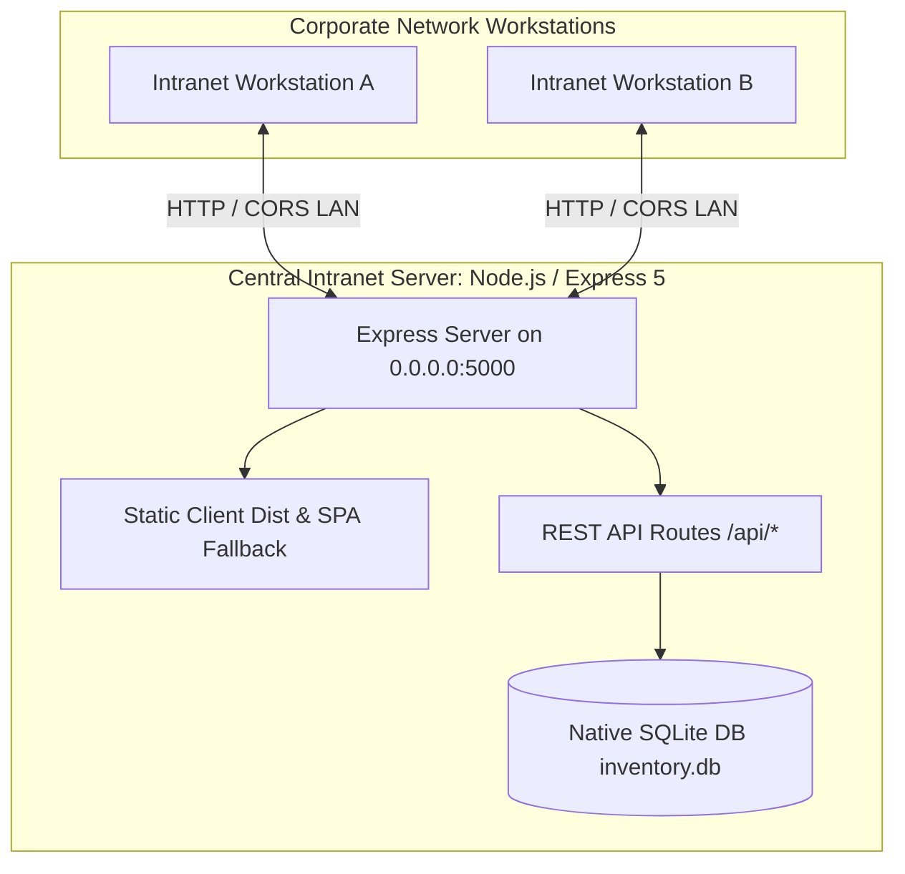
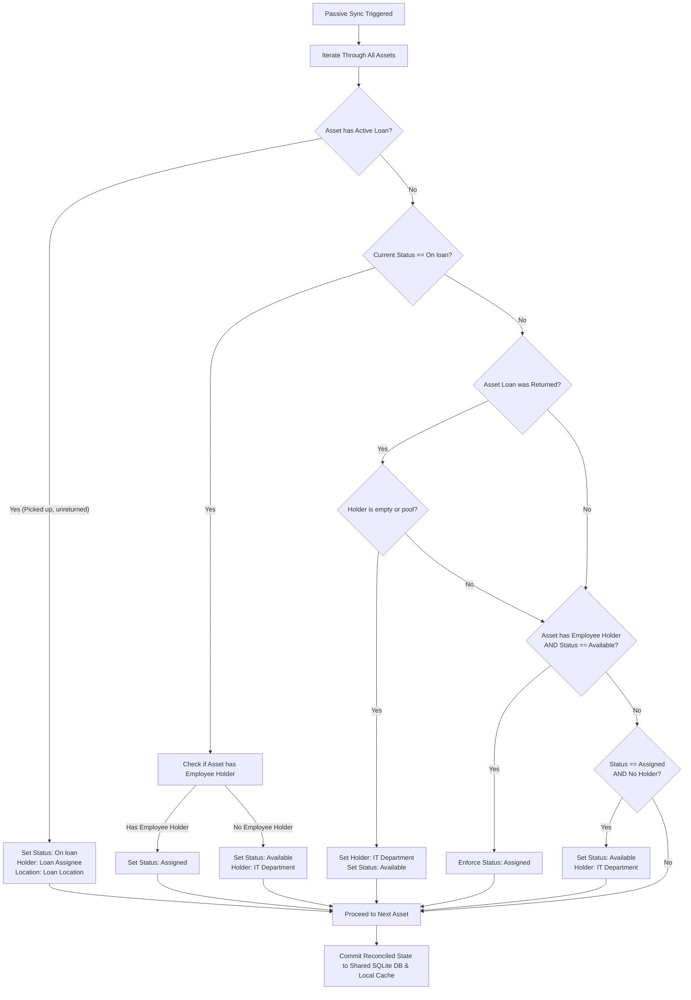

# StarPlus Energy Asset Management System — Technical Specification

| Metadata | Details |
| :--- | :--- |
| **Specification Version** | **v1.12.4** |
| **System Name** | StarPlus Energy Asset Management System (SPE-AMS) |
| **Specification Status** | Approved / Production Architecture |
| **Release Date** | November 12, 2026 |
| **Target Runtime** | Corporate Intranet Server & Modern Browsers (Chromium 100+, Firefox 100+, Safari 16+) |
| **Source Repository** | [Inventory-Management-Software](file:///c:/Users/Developer/Documents/workspace/Inventory-Management-Software) |
| **Related Documents** | [Software Design Document.md](file:///c:/Users/Developer/Documents/workspace/Inventory-Management-Software/Software%20Design%20Document.md), [PATCH_NOTES.md](file:///c:/Users/Developer/Documents/workspace/Inventory-Management-Software/PATCH_NOTES.md) |

---

## 1. Technology Stack Architecture

The system is engineered as a **Corporate Intranet Client-Server Application**, hosted centrally on an intranet server (`0.0.0.0:5000`) and accessible to multiple workstations across the corporate network, with centralized SQLite database persistence, background multi-host synchronization, and local browser cache resilience.



### 1.1 Stack Specification

| Tier | Technology | Version | Purpose & Rationale |
| :--- | :--- | :--- | :--- |
| **Server & HTTP** | **Node.js & Express** | `^5.3.0` | High-performance server binding to `0.0.0.0:5000` with LAN CORS and static SPA hosting. |
| **Database** | **SQLite (`node:sqlite`)** | Native Node.js | Centralized embedded database in WAL mode (`server/data/inventory.db`) with full transactional persistence. |
| **UI Library** | **React** | `^19.0.0` | Declarative UI rendering, modern hooks (`useCallback`, `useMemo`), optimistic mutations. |
| **DOM Renderer** | **React DOM** | `^19.0.0` | Client-side DOM mounting and tree reconciliation. |
| **Build Tooling** | **Vite** | `^6.0.0` | Sub-second cold starts, Hot Module Replacement (HMR), tree-shaken static production bundling. |
| **Vite Plugin** | **@vitejs/plugin-react** | `^4.3.0` | Fast Refresh transform pipeline. |
| **Client Routing** | **React Router** | `^7.0.0` | Lightweight declarative SPA routing (`BrowserRouter`, `Routes`, `Route`, `useNavigate`, `useLocation`). |
| **Styling** | **Vanilla CSS** | Standard CSS3 | CSS Custom Properties (`--blue: #1449d6`, `--ink: #141519`, etc.), responsive flexbox/grid. No Tailwind runtime or precompiler dependencies. |
| **Typography** | **System Font Stack** | Native OS | `-apple-system, BlinkMacSystemFont, "Segoe UI", Roboto...` ensuring clean native rendering without remote font downloads. |
| **Client Cache** | **LocalStorage Engine** | Web Storage API | Client-side snapshot cache for instantaneous initial paint and offline network disconnection fallback. |
| **Spreadsheet Engine** | **Native OpenXML** | Custom ES Module | Zero-dependency pure JavaScript `.xlsx` parser/generator utilizing raw ZIP/DEFLATE OpenXML structures. |

---

## 2. Component Architecture & Directory Structure

```
Inventory-Management-Software/
├── index.html                   # HTML entry point (clean system typography, zero CDNs)
├── package.json                 # Project manifest (version sourced from package.json)
├── vite.config.js               # Vite 6 configuration with React plugin & loopback IPv4 proxy
├── server/                      # Shared Corporate Intranet Express & SQLite Backend
│   ├── index.js                 # Express 5 server binding to 0.0.0.0:5000, LAN CORS, SPA fallback
│   ├── config.js                # Server configuration (port, host, dbPath, admin & operator accounts)
│   ├── db/
│   │   └── database.js          # Native SQLite (node:sqlite) setup, WAL mode, schema, seed, audit & snapshots
│   ├── middleware/
│   │   └── auth.js              # Authentication & JWT/cookie token verification
│   └── routes/
│       ├── assets.js            # Hardware inventory CRUD, batch operations, ownership transfer
│       ├── loans.js             # Custody checkouts, pickups, returns, accessory tracking
│       ├── directory.js         # Employees, departments, locations, transfer reasons
│       ├── stats.js             # Fleet KPIs and audit logs
│       ├── exchange.js          # Full DB export, TXT import with rollback snapshot, and revert
│       └── auth.js              # User login, logout, profile, and user management
├── src/
│   ├── main.jsx                 # Application entry point, mounts AppShell inside BrowserRouter
│   ├── App.jsx                  # Top-level route switch & context providers
│   ├── index.css                # StarPlus Energy design system, tokens, and utility classes
│   ├── components/
│   │   ├── AppShell.jsx         # Global layout shell (Sidebar + Main panel + PatchHistoryModal + Toast)
│   │   ├── Sidebar.jsx          # Collapsible navigation, hexagon SVG brand mark, clickable version indicator
│   │   ├── TopBar.jsx           # High-density ~32px header, title, clickable version pill, offline indicator
│   │   ├── InOutCalendar.jsx    # Unified in/out schedule calendar with requester filtering & day inspection
│   │   ├── PatchHistoryModal.jsx# In-app release notes viewer per version with search & filtering
│   │   ├── TravelerCalendar.jsx # Monthly schedule calendar with location filtering & day inspection
│   │   ├── Modal.jsx            # Accessible overlay modal dialog with backdrop dismiss
│   │   ├── AssetTable.jsx       # Interactive data grid, drag selection, batch actions, click-to-transfer badges
│   │   ├── AssetForm.jsx        # Asset registration and editing modal form
│   │   ├── ChangeOwnerModal.jsx # Direct ownership transfer dialog with custom reasons
│   │   ├── LoanForm.jsx         # Internal loan checkout form with equipment checklist
│   │   ├── StatCard.jsx         # High-level KPI metric card with icon & status styling
│   │   ├── BarChart.jsx         # Category distribution chart
│   │   └── Toast.jsx            # Non-blocking feedback notification toast
│   ├── pages/
│   │   ├── OverviewPage.jsx     # Executive dashboard, KPIs, quick filters, category mix
│   │   ├── AssetsPage.jsx       # Hardware inventory register, multi-column search, batch operations
│   │   ├── LoansPage.jsx        # Searchable custody records, editable pickup/return details, overdue tracking
│   │   ├── CalendarPage.jsx     # Dedicated In & Out Calendar with multi-tier requester filtering
│   │   ├── BusinessTravelersPage.jsx # Mobile workforce roster list, overdue triage, location matrix
│   │   ├── DirectoryPage.jsx    # Employees with Knox IDs, departments, facility locations
│   │   └── ExchangePage.jsx     # TXT import (extracted from Excel) & 1:1 Excel export (.xlsx)
│   ├── hooks/
│   │   ├── useDb.jsx            # Database context hook providing data access, sync & mutations
│   │   └── useToast.jsx         # Toast notification dispatch hook
│   ├── lib/
│   │   ├── api.js               # Enterprise REST API client (Fetch wrapper with Bearer token & cookies)
│   │   ├── assetExcel.js        # Equipment register column mapping & row serialization
│   │   ├── assetIntegrity.js    # States Version 1.0.0 state machine, passive sync, history engine
│   │   ├── constants.js         # APP_VERSION (derived from package.json), status enums, Excel headers, default reasons
│   │   ├── db.js                # LocalStorage engine, import backup snapshots, transfer reasons cache
│   │   ├── txtImport.js         # Delimited text parser & format detector for TXT extracted from Excel
│   │   ├── utils.js             # Date formatters (ISO, readable), ID generators, sanitizers
│   │   └── xlsx.js              # Pure JavaScript OpenXML (.xlsx) builder and parser
│   └── data/
│       ├── patchHistory.js      # Structured release notes data per version (SemVer 2.0.0)
│       └── seed.js              # Sample fixtures and reference defaults; operational samples are not automatically loaded
```

---

### 2.1 Shared Modules and Change Ownership

Update the shared module for a rule or field mapping, then import it at each caller instead of copying the implementation.

| Module | Responsibility |
| :--- | :--- |
| `shared/referenceData.js` | Default asset statuses, transfer reasons, and location names used by both application tiers. |
| `shared/assetRules.js` | Location normalization, repair destinations, and asset status transitions during loan edits and returns. |
| `shared/assetDates.js`, `shared/dateTime.js` | Calendar-date validation and explicit DD-MM-YYYY form / MM-DD-YYYY legacy import conversion; local display of zoned timestamps without changing their stored instant. |
| `shared/assetReferences.js`, `shared/assetReturns.js` | Exact device-reference renaming and per-device return accounting across linked custody records. |
| `shared/loanRules.js`, `shared/loanIdentity.js` | Returned-loan detection, traveler classification, and import matching identities. |
| `src/lib/equipmentSchema.js`, `spreadsheetValues.js` | Equipment column aliases, status translations, header lookup, and spreadsheet value parsing shared by TXT and XLSX paths. |
| `src/lib/loanEquipment.js`, `loanSelectors.js` | Checklist mappings, partial returns, loan grouping, and search. |
| `src/lib/calendarDates.js`, `src/hooks/useCalendarMonth.js` | Calendar grids and month navigation. |
| `src/lib/inOutSchedule.js`, `transferNotes.js` | Pending pickup indexes shared by both calendars and readable presentation of legacy generated transfer notes. |
| `src/components/DirectoryPanel.jsx`, `DirectorySelect.jsx`, `LoanEquipmentFields.jsx`, `IPAddressFields.jsx` | Reusable directory and loan form controls. |
| `src/lib/databaseLocations.js` | Immutable location normalization for browser cache, imports, restores, and state updates. |
| `server/lib/assetRows.js`, `loanRows.js` | Shared database row serialization; explicit API and export profiles retain their respective defaults. |
| `server/lib/assetLocations.js`, `assetLoans.js`, `loanDuplicates.js` | Transactional location migration, custody resets, and exact duplicate loan cleanup. |
| `server/lib/assetCustody.js`, `assetReferences.js`, `assetReturns.js`, `assetDates.js` | Idempotent IT-custody history repair, transactional reference updates, linked device returns, and additive date-column migration. |

The default location is **IT Office**, distinct from the **IT Department** owner. Legacy **Head Office** and **IT Department** location labels normalize to IT Office on startup, import, and restore. Assets with status **Under repair** always use **service center**, which is registered in the location directory automatically. Single and batch asset forms display this destination without allowing it to be overridden while the repair status is selected. Editing an ongoing loan or returning custody preserves a repair recorded on its asset; an explicit new pickup follows the normal handover transition. Rental locations remain independent of an asset's repair destination.

Run `npm test` for the built-in Node.js regression suite. Tests cover shared rules, import mappings, calendar dates, loan identities and grouping, serializers, and database migration rollback using in-memory SQLite. Run `npm run build` to check the complete frontend. Browser-local date formatting and server UTC dates retain their separate purposes.

---

## 3. Data Schema & Models (Schema Version 1.0.0)

### 3.1 Asset Master Record (`Asset`)

Purchase and warranty expiration dates are available for every asset category. Forms display and accept `DD-MM-YYYY` (for example, `07-10-2023` for 7 October 2023). AssetForm passes the explicit entry format for display, validation and serialization; import and API conventions retain their existing behavior. Shared date helpers convert values to `YYYY-MM-DD` for storage and validate calendar dates and warranty ordering without timezone shifts. Existing ISO inputs remain supported.

```typescript
interface Asset {
  id: string;                      // UUID primary key (crypto.randomUUID())
  code: string;                    // Master Asset Code (e.g., "SPE-1001", "SPE-1002")
  name: string;                    // Display name (e.g., "ThinkPad T14s Gen 3")
  category: string;                // "Laptop" | "Desktop" | "Monitor" | "Peripherals"
  model: string;                   // Hardware model string
  serial: string;                  // Manufacturer serial number
  status: AssetStatus;             // "Available" | "Assigned" | "On loan" | "Damaged" | "Under repair" | "Retired"
  location: string;                // Facility / Room (e.g., "HQ - Storage Room 2B", "Kokomo Plant")
  purchaseDate?: string;           // Optional purchase date for any asset type (ISO storage)
  warrantyExpirationDate?: string; // Optional warranty end date for any asset type (ISO storage)
  owner: string;                   // Current holder name (Employee Name or "IT Department")
  department: string;              // Assigned department (e.g., "Engineering", "Quality Control")
  condition: string;               // "New" | "Good" | "Fair" | "Needs Maintenance"
  notes: string;                   // General administrative notes
  issuedDate?: string;             // Date asset was issued to current owner
  updated: string;                 // ISO date string of last modification ("YYYY-MM-DD")
  ownershipHistory: OwnershipEntry[]; // Chronological audit trail
}
```

### 3.2 Ownership History Entry (`OwnershipEntry`)

```typescript
interface OwnershipEntry {
  id: string;                      // UUID primary key
  date: string;                    // Timestamp of event ("YYYY-MM-DD HH:mm:ss")
  previousOwner: string;           // Prior holder (e.g., "John Doe", "IT Department", or "None")
  newOwner: string;                // Incoming holder (e.g., "Jane Smith" or "IT Department")
  location?: string;               // Physical location at time of transfer
  department?: string;             // Department at time of transfer
  reason: string;                  // Standardized or custom transfer reason
  notes?: string;                  // Contextual handover notes
}
```

### 3.3 Internal Loan Record (`Loan`)

```typescript
interface Loan {
  id: string;                      // UUID primary key
  assetCode: string;               // Asset.code reference; may be empty when scheduling
  assignee: string;                // Optional borrower name, stored as an empty string if skipped
  knoxId: string;                  // Only required field in the add form and create API
  department: string;              // Borrower's department
  location: string;                // Checkout facility / rental location
  ip: string;                      // Assigned static or leased IP ("105.101.x.x")
  startDate: string;               // Agreement start date ("YYYY-MM-DD")
  pickupDate?: string;             // May be supplied on creation to record handover directly
  endDate: string;                 // Scheduled return due date ("YYYY-MM-DD")
  returnDate?: string;             // Actual date hardware was returned to IT
  status: LoanStatus;              // "Scheduled" | "Active" | "Returned" | "Overdue" | "Transferred"
  equipment: EquipmentChecklist;   // Itemized accessories
  returnedEquipment?: EquipmentChecklist; // Actual returned quantities, displayed for any recorded return
  returnStatus?: 'Partial' | 'Complete'; // Return completeness independently of loan due date/status
  readyForPickup?: boolean;        // Scheduled loan preparation flag
  others?: string;                 // Miscellaneous items
  note?: string;                   // Custody instructions
  isArchived?: boolean;            // Soft-archive flag for returned or fully transferred loans
}

interface EquipmentChecklist {
  Laptop?: string;                 // Actual PC asset number; may be blank during scheduling
  RequestedPC?: boolean;           // PC requested before asset assignment
  RequestedMonitor?: boolean;      // Monitor requested before asset assignment
  Adapter: number;                 // Power adapter count
  Cable: number;                   // Power cable count
  Dongle: number;                  // USB-C / Display adapter count
  Keyboard: number;                // External keyboard count
  Mouse: number;                   // External mouse count
  Monitor: number | string;        // Legacy count or registered monitor asset code
  'Ethernet cable': number;        // RJ45 patch cable count
}
```

---

## 4. States Version 1.0.0 & State Machine Architecture

### 4.1 Asset States Taxonomy

```
+-------------------------------------------------------------------------+
|                        STATES VERSION 1.0.0                             |
+------------------+-----------------------+------------------------------+
| State Code       | Semantics             | Holder Constraint            |
+------------------+-----------------------+------------------------------+
| Available        | Available in IT custody | IT Department             |
| Assigned         | Dedicated allocation  | Named employee / department  |
| On loan          | Temporary checkout    | Active loan assignee         |
| Damaged          | Defective / offline   | IT Department / Reporting    |
| Under repair     | Active maintenance    | IT Department / Vendor       |
| Retired          | Decommissioned asset  | Decommissioned Archive       |
+------------------+-----------------------+------------------------------+
```

### 4.2 Passive Verification & Sync Service Algorithm

The application does not depend on manual user triggers to reconcile data consistency. Instead, integrity reconciliation executes across both architectural tiers:
- **Client Tier (`src/lib/assetIntegrity.js`)**: `reconcileAllAssets()` runs passively whenever the client mounts, mutates local state, regains window focus, or completes a 15-second background sync.
- **Server Tier (`server/db/database.js`)**: `reconcileAllAssetsInDb()` runs directly within the shared SQLite database during server boot, loan checkout/pickup, return processing, and data exchange imports (`/api/exchange/import`), writing normalized states directly to the database.



### 4.3 Return Workflow Specification
When a loan is returned via `returnLoan(loanId)`:
1. `loan.returnDate` is stamped with the current date (`todayIso()`).
2. `loan.status` transitions to `'Returned'`.
3. The associated asset is retrieved:
   - `asset.owner` is set strictly to `'IT Department'`.
   - `asset.department` is cleared (`''`).
   - `asset.status` transitions to `'Available'` while preserving Damaged, Under repair, Retired, or legacy Disposed maintenance states.
   - `asset.location` becomes `IT Office`; Under repair equipment retains its automatic `service center` destination.
   - An `ownershipHistory` entry is created:
     ```javascript
     createOwnershipEntry({
       previousOwner: loan.assignee,
       newOwner: 'IT Department',
       reason: 'Returned to IT Department',
       notes: `Loan completed. Returned on ${todayIso()}`
     })
     ```
4. The passive verification service validates that no other active loans exist for this asset code and commits the transaction.

Scheduled records cannot be returned through full edit, direct return, or bulk return before pickup. Historical return records remain editable. Clearing an existing holder or explicitly selecting Available records IT custody and a persistent history event; linked pickup records check in only the affected device, preserving outstanding equipment. Startup and exchange restoration repair older Available records with missing IT custody/history once, labeling observation time when the historical return date is unknown.

The Scheduled table and expanded details omit return information. Overdue omits the return-date column and expanded return time, and return-date records are grouped as Returned before overdue classification.

### 4.4 Pending Schedule Presentation

Both `InOutCalendar.jsx` and `TravelerCalendar.jsx` use the pending pickup index in `src/lib/inOutSchedule.js`. Their open-day dialogs derive lists from current records instead of keeping copied event arrays. Pickup, return, or transfer removes the pending pickup event and updates counts. Both calendar templates use one-column, full-width rows with responsive inner details. Scheduled entries cannot offer return actions.

---

## 5. Direct Ownership Transfer Engine

The Assets table allows instantaneous ownership reassignment by clicking directly on the holder badge:

1. **Trigger**: User clicks `<button className="badge-clickable">` showing the current holder name.
2. **Modal Presentation**: `ChangeOwnerModal.jsx` mounts with target asset metadata pre-populated.
3. **Data Inputs**:
   - **New Owner**: Typeahead or manual input of employee name or `"IT Department"`.
   - **Department**: Optional department affiliation.
   - **Effective Date**: Defaults to current ISO timestamp.
   - **Transfer Reason**: Standard dropdown selection or custom text.
   - **Notes**: Operational commentary.
4. **Execution (`changeAssetOwner(assetId, transferData)`)**:
   - Updates `asset.owner` and `asset.department`.
   - If the new owner is blank or `newOwner === 'IT Department'`, records IT custody and enforces `status: 'Available'`.
   - If `newOwner !== 'IT Department'`, enforces `status: 'Assigned'`.
   - Appends audit entry to `asset.ownershipHistory` retaining `previousOwner`.
   - Persists state to the shared SQLite database via `api.assets.transfer` (recording audit entry in `ownership_history` and logging to `audit_logs`), updates local storage cache, and broadcasts toast notification.

---

### 5.1 Loan Equipment Transfers

`POST /api/loans/:id/transfer` accepts `knoxId`, optional `assignee`, `assigneeType`, `startDate`, `endDate`, optional `scheduleId`, and a `selection` object keyed by equipment storage names. The source must have a pickup date and remain outstanding. The new Knox ID must differ from the source owner. Business travelers require valid start and end dates with end on or after start. A selected schedule supplies recipient identity and default dates and must still await pickup. `shared/loanTransfer.js` validates device identities and quantities and splits transferred equipment from remaining custody.

`server/lib/loanTransfer.js` uses a SQLite savepoint to create the destination record or fulfill the selected schedule in place, update the source, and record ownership changes for registered PCs and monitors. Any failure rolls back all those writes. Source and destination notes link the records and retain transferred item values. A fully transferred source uses stored status `Transferred` and `isArchived = 1`; its table label remains Transferred in the archived lifecycle group. The transfer leaves actual return dates blank. The destination records pickup at transfer time with reviewed dates and recipient rental context. Fulfilling a schedule preserves its ID and notes, replaces planned quantities with actual transferred equipment, clears readiness, and sets `equipment.PickupMethod` to `Transfer`. The table displays Pickup by transfer beside its pickup time. Employee destinations have no due date.

`LoanTransferForm.jsx` provides select-all, individual item selection, and numeric quantities. It requires server success and reloads the shared database before dismissing. `Confirm pickup` persists the selected PC code in both the loan asset reference and equipment checklist. Requested PC and monitor flags are retained across schedule, full edit, and pickup; rental location inputs accept Directory suggestions or manual text.

## 6. Native OpenXML Spreadsheet Engine (`lib/xlsx.js`)

To guarantee 100% offline air-gapped capability without external npm libraries or network CDNs, the application bundles a native OpenXML engine.

### 6.1 Package Architecture
The engine constructs valid ZIP-compressed OpenXML packages containing:
- `[Content_Types].xml`: Declares workbook and sheet content types.
- `_rels/.rels`: Package relationship graph.
- `xl/workbook.xml`: Sheet registry and namespaces.
- `xl/_rels/workbook.xml.rels`: Worksheet target mappings.
- `xl/worksheets/sheet1.xml`: Cell table data with row/column coordinate references.
- `xl/styles.xml`: StarPlus Energy enterprise styling (Corporate Blue headers, borders, font definitions).
- `xl/sharedStrings.xml`: Deduplicated string lookup table.

### 6.2 1:1 Schema Mapping Table

| Export Column | XML Cell Type | Source Property | Fallback / Formatting |
| :--- | :--- | :--- | :--- |
| `no` | Number | `index + 1` | `1, 2, 3...` |
| `Name` | String | `loan.assignee` | `""` |
| `Knox ID` | String | `loan.knoxId` | `""` |
| `Rental Location` | String | `asset.location \|\| loan.location` | `""` |
| `IP` | String | `loan.ip` | `""` |
| `Start Date` | String | `loan.startDate` | `YYYY-MM-DD` |
| `Pickup Date` | String | `loan.pickupDate` | `YYYY-MM-DD` |
| `End Date` | String | `loan.endDate` | `YYYY-MM-DD` |
| `Return Date` | String | `loan.returnDate` | `YYYY-MM-DD` |
| `Laptop` | String | `loan.assetCode` | `SPE-XXXX` |
| `Charging Adapter` | Number | `loan.equipment.Adapter` | Default `1` |
| `Charging Cable` | Number | `loan.equipment.Cable` | Default `1` |
| `Dongle` | Number | `loan.equipment.Dongle` | Default `0` |
| `Keyboard` | Number | `loan.equipment.Keyboard` | Default `0` |
| `Mouse` | Number | `loan.equipment.Mouse` | Default `0` |
| `Monitor` | Number | `loan.equipment.Monitor` | Default `0` |
| `Ethernet cable` | Number | `loan.equipment['Ethernet cable']` | Default `0` |
| `others` | String | `loan.others` | `""` |
| `Note` | String | `loan.note` | `""` |

### 6.3 Shared Data Exchange & Transactional Backup Engine (`server/routes/exchange.js`)

The system implements a centralized data exchange engine backed by transactional SQLite operations and audit logging:

1. **Full Database Export (`GET /api/exchange/export`)**:
   - Queries and packages all master records (`assets`, `ownership_history`, `loans`, `employees`, `departments`, `locations`, `transfer_reasons`) into a structured JSON payload.
   - Powers the client's automated multi-host synchronization (15-second polling interval and window focus events in `useDb.jsx`).

2. **Transactional Ingestion with Automated Snapshot (`POST /api/exchange/import`)**:
   - Accepts parsed asset and loan datasets extracted from `.txt` or `.xlsx` files.
   - Before executing writes, triggers `createSnapshot()` to serialize the current database state into the `import_backups` table with a unique timestamped identifier (`snap-<timestamp>`).
   - Executes mutations inside a SQLite transaction (`BEGIN TRANSACTION ... COMMIT`):
     - Inserts or updates assets based on code parity.
     - Automatically creates and records initial or overwrite history entries in `ownership_history`.
     - Resolves loan identity through `shared/loanIdentity.js`, preserving matched IDs before upserting JSON accessory checklists and soft-archive flags. The preview and client merge use the same matcher.
     - Matches exact IDs first, then asset/person identifiers and start, pickup, or return dates. When only one side lacks start/pickup dates, a single candidate is required for the asset/person fallback.
     - Preserves blank imported start dates and removes exact duplicates; the response reports imported and updated loan counts separately.
   - Automatically invokes `reconcileAllAssetsInDb()` immediately after commit to validate and enforce all States v1.0.0 rules.
   - Records an `IMPORT_DATA` event in `audit_logs` tracking snapshot ID, imported counts, and actor identity. If an error is encountered, the transaction triggers an automatic `ROLLBACK`.

3. **One-Click Transactional Revert (`POST /api/exchange/revert`)**:
   - Accepts an optional `snapshotId`; otherwise locates the latest restorable snapshot from `import_backups`. `GET /api/exchange/backup-status` exposes up to 50 history entries.
   - Executes an atomic rollback within `BEGIN TRANSACTION ... COMMIT`: wipes working tables (`ownership_history`, `assets`, `loans`, `employees`, `departments`, `locations`) and re-populates them with the exact snapshot dataset.
   - Saves the current database before restoration and retains the selected snapshot in history. The client reloads the restored database.

4. **Startup Duplicate Repair**:
   - Database initialization saves a restore point when cleanup is needed, clears start dates later than return dates on records without pickup dates, and removes exact duplicates using the shared semantic comparison.
   - Duplicate comparison excludes IDs and creation timestamps and canonicalizes equipment JSON. Records with differing details are retained.

5. **Loan Entry & Equipment Search**:
   - `POST /api/loans` requires Knox ID; empty asset and assignee strings are accepted. Empty asset and employee records are not created.
   - The add form can record pickup immediately. PC suggestions are filtered to Laptop, MES PC, and PC; monitor suggestions and submitted monitor codes must refer to Monitor/Monitors inventory records.
   - The Loans table displays and sorts PC asset numbers, replacing the sequence-number column.

---

## 7. Performance & Build Metrics

Production assets are generated by `npm run build`. Route pages use lazy imports and Suspense; the patch history modal and spreadsheet processing load on demand. This keeps those features out of the initial JavaScript bundle.

Use the current Vite build output for chunk sizes and gzip estimates. Bundle sizes and build duration vary by release and environment; the project does not claim a measured initial-paint guarantee.

---

## 8. Patch History Architecture & Layout Guarantees

### 8.1 Access Pattern
The patch history system is accessible via:
1. **Interactive Global Modal (`PatchHistoryModal.jsx`)**:
   - Triggered from any page via the TopBar version button or the sticky bottom-left Sidebar footer pill, keeping the main sidebar menu clean and uncluttered.
   - Direct button in the Business Travelers view header (`view-header-actions`), ensuring instant visibility alongside view mode toggles.
   - Pinned header and filter controls with internal scrolling stream (`.patch-cards-stream`).
   - Anchored from the top (`margin: 12px auto !important; align-items: flex-start; z-index: 100000;`) to prevent header clipping in all viewport heights.
2. **Dedicated Full-Page Route (`PatchHistoryPage.jsx`)**:
   - Routed at `/patch-history` and `/changelog` for direct deep-linking when needed.

### 8.2 Layout Overflow & Obscurity Prevention
- **Sticky Sidebar Positioning**: `.sidebar` is styled with `position: sticky; top: 0; height: 100vh; max-height: 100vh; flex-shrink: 0; overflow-y: auto;`. This ensures that on tall pages (such as Business Travelers), the bottom-left version info remains permanently pinned in the viewport without scrolling out of sight.
- **Card Flex-Shrink Prevention**: `.patch-card`, `.patch-card-header`, and `.patch-card-body` are configured with `flex-shrink: 0 !important; min-height: min-content !important;`. This prevents CSS flexbox from squishing cards into flat horizontal lines when multiple versions are expanded, allowing the cards to render at full natural height with an active vertical scrollbar on `.patch-cards-stream`.
- **Container Constraints**: `.main-content` is styled with `max-width: calc(100vw - 252px); overflow-x: hidden; min-width: 0;` to ensure wide tabular or calendar content never expands the viewport horizontally.
- **Component Horizontal Scrollers**: `TravelerCalendar` and tables are wrapped in containers with `overflow-x: auto; max-width: 100%;`, preserving the visibility of `.top-actions` and TopBar version pills regardless of display resolution.
- **Exclusive Calendar View**: On `/business-travelers`, activating Calendar View cleanly hides KPI stat cards, location breakdown lists, overdue blocks, and roster tables, ensuring the schedule calendar receives 100% of the focus area.


## 9. Shared Workflow Contracts & Release Maintenance

- Directory location rename accepts names or IDs. It updates asset and assignment/loan references atomically; naming an existing destination merges into that entry and preserves its ID. Trim outer whitespace, preserve internal spaces, and reject deletion while assets use a location. Historical rental records do not recreate deleted directory values.
- New transfer recipients default to Business traveler; selecting a pickup schedule retains its borrower type. Transfer windows persist the selected effective timestamp. Ownership history uses saved dates rather than generating a new date during rendering.
- Shared pickup/return forms group PC and monitor asset-number fields with accessory quantity inputs. Quantities are whole numbers at least zero; adapter/cable default to 1 only when PC is requested. Others / Peripherals is text. A standalone PC value of 1 denotes a quantity/request and is not tracked as an asset number.
- Scheduled and All records share the pickup-readiness switch; readiness is inapplicable after pickup or return. Every custody tab includes the shared sortable Location column. Calendar Hide returned filters the event index used by grid cells, summary counts and open-day details.
- Common form initialization, validation, payload creation and partial-return accounting live in src/lib/loanForms.js. Equipment metadata lives in shared/equipment.js; defaults live in shared/referenceData.js. The design document lists component ownership.
- Every completed code update includes a SemVer increment, a new structured release-history entry and affected-document updates. npm run docs:sync generates patch notes and synchronizes manifest, lockfile and document metadata; previous releases remain unchanged.

### Traveler follow-up and transfer synchronization

`src/lib/travelerFollowUp.js` uses `groupLoans` for overdue and partial-return eligibility. Recipient output excludes blank IDs, deduplicates case-insensitively, sorts IDs, and appends `;` after every recipient. Clipboard failure leaves a read-only selectable list available. Traveler calendar return filters distinguish future/current expected returns, actual returns and overdue picked-up equipment; pending pickups do not produce return events. `CalendarPickupReadiness` uses the shared `PickupReadiness` control and `setLoanReadyForPickup` in both day dialogs. Scheduled transfer equipment is replaced rather than checked against the plan; existing transaction rollback and recipient/date validation remain enforced. AssetForm resynchronizes its draft when the saved asset object changes, so ownership transfers update open details immediately.

The asset-transfer endpoint applies `recordHolderReturn` for both returns to IT and changes to another holder, inside the same asset/history transaction. Responses include affected loans for cache synchronization. Employee creation uses UUID-based IDs. Regression coverage transfers without an asset PUT, reads a fresh export and reconciles it, verifying that the new holder persists and missing accessories remain outstanding. Calendar day rows omit Scheduled badges for pending pickups, and the readiness wrapper renders only the shared switch.

`DbProvider` captures the current database revision before background export requests and rejects the response if a local state write occurred before completion. This prevents pre-transfer snapshots from overwriting the saved holder in the browser cache. Calendar row CSS shares content-sized flex regions in both calendar modules, with wrapping values, compact actions and an 850px breakpoint for details wrapping.

`normalizeAvailableAsset` also enforces IT custody for Under repair. `getHolderReturnChanges` recognizes a repair status change even when a stale employee holder is supplied. Single and bulk asset writes check in the affected device through `recordHolderReturn`, clear department, retain maintenance status and service-center location, and record ownership changes. Regression coverage exercises both write paths, fresh exports and reconciliation while verifying accessory shortages remain partial.

Both pickup form and pickup API permit RequestedMonitor=true with an empty Monitor field. This records the request without forcing an unavailable monitor assignment; PC validation remains unchanged. Regression coverage confirms pickup succeeds and retains the request with no monitor asset assignment.

`indexInOutSchedule` adds `pickedUpByDate` using the normalized actual pickup timestamp; `scheduleForDay` returns filtered `pickedUp` records along with pending outgoing and incoming returns. Both calendar modules render CalendarPickedUpSection and support Picked up filters. CalendarReturnFilter is a shared accessible switch with role=switch and aria-checked; toolbar and modal instances update the same hideReturned state. Regression coverage verifies date placement, return exclusion and restoration, and custom day filtering.

### Build and restart data preservation

The build script remains vite build and has no database or TXT-import hooks. DbProvider no longer invokes exchange.importData during background refresh; all successful exports replace cached collections even when empty. loadDb uses an empty operational database for absent/corrupt cache entries, and cached assets are not supplemented with samples. seedDefaultData initializes accounts and references but does not reseed assets, loans or employees. Startup regression tests use a temporary DB_PATH and separate processes to verify edited end_date values and intentionally empty tables survive restarts. Keep DB_PATH and SQLite files separate from frontend deployment artifacts.

`travelerReminders` excludes non-travelers, pending pickups and returned records, normalizes due/end dates and compares UTC calendar-day indices to the supplied local today date. Inclusive daysLeft 0..7 are sorted ascending. TravelerContactList reuses knoxRecipientList and shared clipboard/error handling. Overdue rows use SortableHeader buttons with aria-sort and sortTableRows for natural text and numeric comparisons; due dates sort chronologically, overdue duration numerically, and missing values last. Location distribution is hidden for followup and reminder view modes.

QUANTITY_FIELDS excludes asset fields. normalizeEquipmentQuantity strips leading zeros from digit-only strings without numeric conversion; normalizeEquipmentQuantities applies it only to count keys, preserving numeric types and legacy descriptions. The record normalizer handles issued and returned equipment at API/import/serialization boundaries. Shared form adapters and payload builders use the same functions. EquipmentQuantityInput notifies forms with canonical digits, permits empty editing, and is reused by transfer quantities. Tests cover input callbacks, payloads, identifiers, transfers and raw SQLite values for create, edit, pickup and return.

DateInput wraps native date and datetime-local controls with a maximum of 9999-12-31 (end of day for timestamps), preserves stricter supplied maxima and existing minima, and ignores nonempty change values without a four-digit ISO year prefix. Clearing remains supported. Shared component tests cover both input types, rejection/restoration, clearing, valid edits and caller-provided minimum dates.

shared/loanLocations.js exposes isPendingPickup and getLoanLocation for camelCase/API and SQLite rows. Empty pending locations remain empty; completed custody keeps the existing default. ScheduleDueDateInput initializes month/day as empty and year from local todayIso, accepts up to four year digits, validates the complete date against an ISO calendar round trip, and emits an empty string for incomplete or invalid dates. Its native DateInput picker fills all segments; existing complete values are preserved. Regression tests cover blank location through create/edit/list/import and calendar enrichment, plus year-only, incomplete and invalid due-date drafts.

ScheduleDueDateInput assigns dedicated date-part and year classes. Scoped CSS gives month/day 3.5ch and year 5.5ch nonshrinking widths, removes inherited horizontal padding, and reserves 30px for the native picker. Date validation and persistence behavior are unchanged.

LoanTransferForm matches its trimmed, lowercased schedule query against both knoxId and assignee using partial substring matching. Existing eligibility checks and selectedOutsideSearch handling are reused. Component coverage exercises name and ID searches, exclusion of picked-up records and selection retention.

loanAssetCodeForUpdate gives an explicitly supplied assetCode or equipment.Laptop precedence even when empty; omitted references preserve existing values. Loan PUT retains Transferred/is_archived and skips active asset synchronization for completed transfers. Transfer provenance in the saved note plus no remaining equipment also completes a corrected partial-transfer sender. The serializer retains Transferred status, and shared returned checks treat transferred records as closed. updateLoan awaits the API, applies its loan/assets response, and full/inline editors keep drafts when saving fails. Integration tests cover full-transfer sender edits, receiver custody preservation, partial-transfer PC correction, exports and repeated edits.

AppShell uses useLocation().pathname and useLayoutEffect to reset window and main-content scroll instantly on initial mount and route changes. It temporarily sets history.scrollRestoration to manual and restores the previous value on unmount. Query-only and within-page state changes do not trigger the pathname effect.
